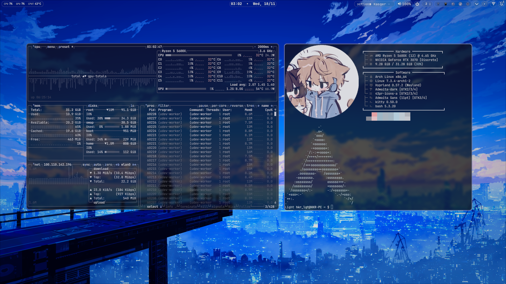

# dotfiles

My Arch Linux + Hyprland setup.



## What's in here

| Part | Tool |
|------|------|
| Window manager | [Hyprland](https://hyprland.org) (0.57, Lua config) |
| Bar, side panel, settings | [Quickshell](https://quickshell.outfoxxed.me) |
| Launcher | rofi |
| Terminal | kitty |
| Lock screen | hyprlock |
| Wallpaper | awww + hyprquickpaper (wallpaper picker) |
| Theming | 43pr theme engine (thank you bro) + matugen (colors from the wallpaper) |
| GTK | custom GTK 3/4 dark theme |
| Extras | cava, fastfetch, nvim |

## Layout

```
.config/
├── hypr/          hyprland.lua, rules.lua, look.lua, hyprlock, scripts/
├── quickshell/    bar, side panel, settings window, wallpaper picker
├── lytx02/          theme engine, templates, color schemes
├── rofi/  kitty/  gtk-3.0/  gtk-4.0/  matugen/  cava/  fastfetch/  nvim/
```

## Install

These dotfiles are stored as a bare git repo in `$HOME`.

```bash
git clone --bare git@github.com:lytx02/dotfiles.git $HOME/.dotfiles
alias config='git --git-dir=$HOME/.dotfiles --work-tree=$HOME'
config checkout
config config --local status.showUntrackedFiles no
```

If `checkout` complains about existing files, back them up or remove them, then run it again.

Set a wallpaper and generate the colors:

```bash
~/.config/lytx02/bin/theme.py wallpaper ~/Pictures/Wallpapers/<image>
~/.config/lytx02/bin/theme.py apply
```

